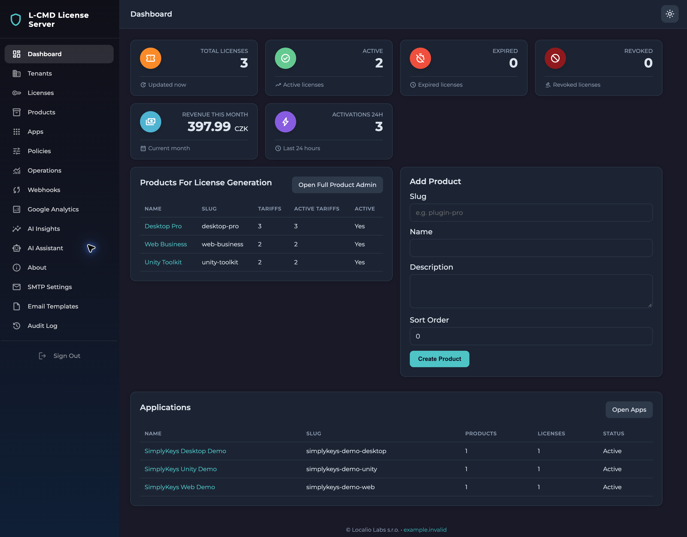
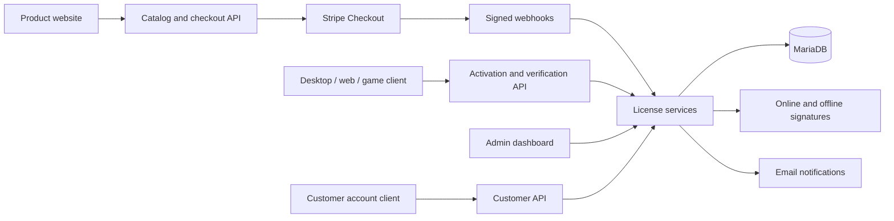

# L-CMD License Server

[](https://github.com/bradacz/l-cmd-licence/actions/workflows/ci.yml)
[](https://github.com/bradacz/l-cmd-licence/actions/workflows/security.yml)
[](LICENSE)

**A self-hosted, open-source platform for software licensing, application access
and subscription billing.**

L-CMD License Server gives developers one backend for issuing licenses,
activating installations, checking access to paid features and processing payment
events. It supports multiple tenants and applications, so separate products can
share an installation with their own configuration, licenses and integration
settings.

The system combines a JSON HTTP API, an administration dashboard, customer-account
endpoints, a product catalog and Stripe/SMTP integrations. It is built in PHP with
MariaDB and can run on infrastructure you control.

## Dashboard



Administration dashboard with synthetic demonstration data, not production
customer records. Open the image to view it at full resolution.

## Who It Is For

- Developers selling desktop software, utilities, plugins and developer tools.
- Teams licensing web applications or self-hosted commercial software.
- Game-tool authors connecting Unity or Unreal applications through HTTP.
- Companies managing several products, customers and installation limits.
- Teams building product websites, customer portals and licensing automations.

Clients can use any language with HTTPS and JSON support: PHP, JavaScript,
TypeScript, C#, C++, Swift, Kotlin, Python or Go. Each client implements the API
calls and enforces the returned permissions in its own application.

## Core Capabilities

| Area | What the system provides |
| --- | --- |
| Tenants and applications | Accounts, memberships, application slugs, product bindings and settings |
| Product catalog | Products, tariffs, currencies, prices and Stripe price references |
| License lifecycle | Issuing, activating, verifying, deactivating, expiring, revoking and refunding |
| Installation limits | Stable installation IDs, device counts and serialized activation changes |
| Access policies | Limits, features, token lifetime, grace periods and allowed platforms |
| Online verification | Expiring HS256 tokens tied to a license and installation |
| Offline verification | RS256-signed licenses validated with a public key |
| Billing | Stripe Checkout, subscription events, refunds and tenant-plan onboarding |
| Notifications | SMTP, templates and application-specific notification settings |
| Email replies | Per-app Reply-To addresses and editable licensing messages |
| AI workspace | Operational summaries, support-reply/email drafts and provider configuration; local deterministic generation today |
| Customer accounts | Onboarding, password reset, sessions and tenant switching |
| Operations | Dashboard, verification/activation history, webhook records and audit logs |
| Website forms | Contact, booking-request and newsletter-interest endpoints with spam controls |

The [system guide](docs/SYSTEM.md) explains the entities, lifecycle and practical
boundaries. The project's MIT software license is separate from the commercial
license records you issue to customers.

## Server Features

### Applications, Products and Licensing

One installation can organize multiple tenant workspaces and applications. Each
application has a name, slug, platform type, website address, checkout return URLs
and support/contact settings. Products are explicitly bound to applications;
tariffs define license types, prices, currencies and payment-provider references.

The licensing API supports initial activation, repeated verification and device
deactivation. License records track the customer, product, status, validity,
activation capacity and purchase/subscription references. Operators can inspect
individual installations, verification history and lifecycle changes from the
dashboard. Trial, monthly, annual, lifetime and whitelabel license types can be
represented; access still depends on the stored status and explicit expiry.

Application/system policies control feature entitlements, allowed platforms,
activation limits, online-token lifetime and grace periods. Offline licensing uses
tenant signing keys and expiring public-key-verifiable tokens. Clients must enforce
the returned permissions themselves; the server is not a client-side DRM engine.

### Billing and Customer Access

Stripe Checkout connects product tariffs to paid license issuance. Signed webhook
handlers process successful checkout, asynchronous payment confirmation,
subscription renewal, refunds and subscription deletion. Duplicate deliveries are
tracked so a repeated event does not issue the same purchase twice.

Customer-account endpoints cover registration/onboarding, login, password reset,
tenant membership and tenant switching. Tenant owners can manage supported
application settings and integrations through the customer API. Platform-plan
billing is separate from the licenses a tenant sells for its own products.

### Administration and Operations

The web dashboard brings together applications, products/tariffs, licenses,
activation and verification records, payment-webhook history and audit activity.
Operational views show recent failures and job counts; integration pages expose
Stripe, SMTP, Google Analytics configuration and the two AI modules described
below. Dashboard totals are operational indicators, not reconciled accounting.

Maintenance tooling can expire licenses, notify customers and prune stale records.
It must be scheduled deliberately; the generic queue worker is not a completed
background-processing system. See [operations](docs/OPERATIONS.md#background-work).

## Email, Templates and Replies

### SMTP Delivery and Sender Settings

Mail is sent through PHPMailer and an SMTP provider. Configure the SMTP host,
port, username, password, TLS/SSL mode, sender address and sender name in
**SMTP Settings**. The server supports global defaults and tenant-specific SMTP
connections, connection checks and test messages. Stored database settings can
override environment defaults; use a mail sink and synthetic recipients in tests.

Each application's **Notification Profile** controls whether its licensing
notifications are enabled, its sender display name and its **Reply-To Email**.
For example, setting Reply-To to `support@example.invalid` directs a customer's
reply to that mailbox without changing the authenticated SMTP sender address.
Use an address you own in a real deployment.

Profiles also store sales/operations contact addresses, a support URL and brand
color. These are available configuration fields, not a promise that every message
automatically copies those addresses or applies all branding fields.

### Editable Licensing Messages

The dashboard provides global lifecycle templates and per-application overrides
for the subject and body. The application detail page includes these message types:

| Message | Purpose | Template key |
| --- | --- | --- |
| License Created | Deliver a newly issued license and purchase/access details | `mail_license` |
| Expiring Soon | Warn before the license expires | `expiring_soon` |
| Expired | Notify the customer that validity has ended | `expired` |
| Renewal Success | Confirm the renewed validity period | `renewal_success` |

License-created messages accept HTML and use `{{name}}`, `{{email}}`, `{{key}}`,
`{{type}}`, `{{expires}}`, `{{price}}` and `{{currency}}`. Lifecycle messages are
plain text and use `{customer_name}`, `{customer_email}`, `{license_key}`,
`{product_name}`, `{license_type}`, `{expires_at}`, `{activation_count}` and
`{max_activations}`. These are two distinct placeholder formats, not interchangeable
syntax. Treat template contents as trusted administrator-authored content.

For example, an expiration reminder can contain:

```text
Subject: Your {product_name} license expires on {expires_at}

Hello {customer_name},
Your license expires on {expires_at}.
Reply to this message if you need help renewing your access.
```

Enable an app override to replace the corresponding default text. Disabling an
override restores fallback behavior; it does **not** suppress that notification.
Use the application's notification switch to disable its licensing mail. Customer
API endpoints also expose effective templates and a test-send action; test sends
are not a complete preview of event-specific placeholder substitution or Reply-To.

To configure customer replies, open **Applications > your application >
Notification Profile**, set **Reply-To Email**, then customize the relevant
template on that application's page. Configure global lifecycle text in
**Email Templates**. Expiration notifications depend on maintenance execution,
and renewal notifications on the billing flow, not just on saving a template.

### Form Confirmations and Support Drafts

Public contact, booking-request and newsletter-interest endpoints can send an
operator notification and a confirmation to the submitter. These confirmations
currently use text defined in `MailService`, not the licensing-template editor;
adapt that text and branding before using them for your own service.

The server does **not** read an inbox through IMAP, manage support conversations or
automatically answer incoming email. Reply-To routes replies to your existing mail
provider. The AI Assistant can prepare a support-reply draft, but reviewing and
sending that draft is a separate, manual action.

## AI Modules and Integration Settings

The administration includes **AI Insights** and **AI Assistant**, with separate
settings and run history. Both accept an application scope so operators can work
with a particular product rather than only a server-wide view.

### AI Insights

Insights summarize existing server records into an operator-readable report:

| Report | Information used |
| --- | --- |
| Ops Summary | License status counts and recent activation/verification totals |
| Webhook Summary | Recent webhook activity and failure counts |
| Failed Jobs Summary | Failed, pending and reserved job counts |
| Audit Summary | Recent audit activity and a pointer to detailed records |

Runs retain their type, application scope, input summary, source context, output
and creation time. These are summaries of stored operational data, not anomaly
detection or evidence that a server is free of compromise.

### AI Assistant

The assistant prepares editable starting points for **Support Reply**, **Email
Draft**, **Product Copy**, **Onboarding Text** and **Policy Draft**. An operator
chooses the task and application, supplies optional context and generates a draft.
The result and input are retained in run history. A support draft can be reviewed
and copied into an email; the module does not send it, change a license, update
policies or publish product text automatically.

### Provider Configuration and Current Behavior

Both modules expose an enabled flag, provider name, model name, encrypted API-key
storage, daily-request-limit setting, prompt-storage preference, sensitive-data
redaction preference and selected application IDs.

**Current generation is local and deterministic.** Insights format database
statistics; assistant drafts use predefined text and append the supplied context.
There is no implemented external LLM request or provider adapter. Saving a provider
name/model/key does not connect a live AI service or make generation model-powered.

The provider, limit, app-selection and privacy settings are stored configuration,
not enforced controls in these generation services. In particular, assistant input
is saved even when the prompt-storage preference is off, and the redaction
preference does not sanitize it. Do not enter passwords, license keys, payment
details or sensitive customer messages. A live AI integration needs provider calls,
enforced authorization/limits, data minimization, retention/redaction behavior and
error handling before it can safely process customer data.

## What Can Connect

| System | Connection | Status |
| --- | --- | --- |
| Desktop apps / CLI tools | HTTPS/JSON; optional offline signatures | Server API implemented; build the client into your app |
| Websites / web apps | Catalog, checkout and licensing endpoints | Implemented; configure origins and return URLs |
| Unity / Unreal tools | C# / C++ HTTP client with stable installation ID | Application types and guidance provided |
| Mobile apps | Native HTTP client | Generic API; native app-store billing is not implemented |
| Stripe | Checkout and signed incoming webhooks | Implemented |
| SMTP providers | PHPMailer, global or tenant-specific settings | Implemented |
| n8n / Make / internal services | Trusted backend HTTP requests | API integration possible; no dedicated connector bundled |
| Google Analytics | Store measurement/configuration details | Configuration only, not analytics-data synchronization |
| External AI providers | Stored provider/model settings; custom adapter required | Current summaries/drafts are deterministic local routines |

See [integrations](docs/INTEGRATIONS.md) for setup and examples, and the
[API guide](docs/API.md) for routes, authentication and request formats.

## Typical Workflow

1. Create a tenant and register an application with a unique slug.
2. Create products/tariffs, bind them to the app and configure access policies.
3. Configure Stripe and SMTP when online payment or email is required.
4. Issue a license administratively or through a validated paid-checkout event.
5. The application submits the license key and a stable installation identifier.
6. The backend checks status, expiry, app ownership and installation capacity.
7. The client enables permitted features and periodically verifies again.
8. Deactivate an installation when moving the license to another device.

Verification can activate an unknown installation when capacity is available.
It is a state-changing operation, not a read-only lookup. Offline clients observe
later revocations only after reconnection or token expiry.



## Technology and Structure

**PHP 8.2+**, MariaDB, PDO, Composer, PHPMailer and PHPUnit 10. The backend uses
its own small router rather than a full application framework or ORM.

```text
public/             Front controller and Apache routing
src/Http/           API handlers and administration UI
src/Services/       Licensing, identity, billing and integrations
src/Repositories/   Prepared PDO queries and persistence
src/Support/        Encryption, configuration and policy utilities
database/          Fresh schema and historical migrations
scripts/           Operator tools, demo data and checks
tests/             Unit, integration and concurrency tests
docs/              System, API, integration and operations guides
.github/           CI, security and dependency-update workflows
```

Transactions and row locks protect critical activation and issuance paths.
Integration credentials are encrypted, passwords are hashed, customer sessions
track account changes and webhook receipts protect against repeated delivery.
See [architecture](docs/ARCHITECTURE.md) for implementation details and tradeoffs.

## Getting Started

Use a dedicated development database and disable external delivery while testing.

1. Install PHP with `curl`, `mbstring`, `openssl` and `pdo_mysql`, Composer and
   MariaDB. Sodium is recommended; OpenSSL GCM is also supported.
2. Run `composer install` and create a local `.env` from [.env.example](.env.example).
3. Configure the database. Generate independent `APP_KEY`, `LICENSE_SALT` and
   `ADMIN_BEARER_TOKEN` values with `openssl rand -hex 32`.
4. Run `php scripts/import_schema.php` against a **new, empty development DB**.
5. Start `php -S 127.0.0.1:8000 -t public public/index.php`.
6. Open `/health`, then `/admin`. Sign in with your local admin token.

The built-in PHP server is for development, not production. Optional example
products and customers are described in [demo setup](docs/OPERATIONS.md#demo-data).

## Tests and Security

```sh
composer validate --strict
composer lint
composer test:unit
composer audit --locked
```

The suite contains **54 tests**. GitHub Actions runs it on PHP **8.2, 8.3, 8.4 and
8.5** with disposable MariaDB 11.8 databases. Integration tests require explicit
opt-in and a database name ending in `_test`:

```sh
LCMD_TEST_DB=1 DB_DATABASE=lcmd_test DB_USERNAME=lcmd_test composer test
```

Provide credentials locally. Tests generate temporary signing secrets, disable
mail and do not load the application `.env`. See [testing](docs/TESTING.md).

GitHub runs Gitleaks, repository hygiene and dependency advisory checks.
Dependabot monitors dependencies and Actions. Changes to `main` require a pull
request with passing checks. CI has no production credentials and deploys nothing.

## Deployment and Boundaries

Production requires HTTPS, a `public/` webroot, protected runtime/environment
files, explicit allowed browser origins and tested backups. Preserve APP_KEY and
offline signing keys when upgrading. Use a supported, patched PHP runtime.

The [operations guide](docs/OPERATIONS.md) explains current limits, including
application-key enforcement, policy precedence, synchronous mail/billing, the
unfinished generic queue worker and dashboard accounting limitations. Read these
before enabling production traffic or scheduled maintenance.

## Documentation

| Guide | Contents |
| --- | --- |
| [System](docs/SYSTEM.md) | Purpose, entities, license lifecycle and FAQ |
| [Integrations](docs/INTEGRATIONS.md) | Apps, websites, Stripe, SMTP and offline verification |
| [API](docs/API.md) | Routes, payloads, authentication, CSRF and responses |
| [Operations](docs/OPERATIONS.md) | Configuration, demos, hosting, backups and limits |
| [Architecture](docs/ARCHITECTURE.md) | Code organization and design choices |
| [Testing](docs/TESTING.md) | Local verification and disposable database tests |
| [Security](SECURITY.md) | Vulnerability reporting and secret handling |
| [Repair history](docs/REVIEW.md) | Correctness fixes and verification history |
| [Contributing](CONTRIBUTING.md) | Pull requests and regression-test expectations |

## License

Open source under the **[MIT License](LICENSE)**. You may use, modify, distribute
and build commercial products with the code under its terms. Preserve the
copyright and license notices when redistributing it. No warranty is provided.

Dependencies keep their own licenses; see [third-party notices](THIRD_PARTY_NOTICES.md).
