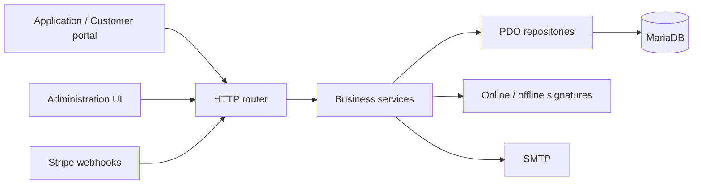

# L-CMD License Server

[](https://github.com/bradacz/l-cmd-licence/actions/workflows/ci.yml)
[](https://github.com/bradacz/l-cmd-licence/actions/workflows/security.yml)

**Multi-tenant PHP backend for software licensing, signed entitlements and billing.**

A framework-free application organized into HTTP handlers, business services and
PDO repositories. This repository is a sanitized source edition for technical
review, not a backup of a running server. It contains no production environment,
customer database, private signing keys or deployment credentials.

## What It Does

- Manages tenants, applications, products, tariffs and license policies.
- Activates, verifies and deactivates installations with transactional limits.
- Issues signed online tokens and offline licenses with stable public keys.
- Handles Stripe checkout and signed webhooks, including retry deduplication.
- Provides a server-rendered administration UI and a customer-portal API.
- Supports tenant-specific SMTP, encrypted integration credentials and audit data.

The separately hosted customer frontend is **not** included. This project is
**L-CMD License Server**, not L-CMS.

## Start Reviewing Here

| Area | Code | What to look for |
| --- | --- | --- |
| License lifecycle | [LicenseService](src/Services/LicenseService.php) | Row locking, limits, expiry and rollback |
| Webhook processing | [StripeWebhookService](src/Services/StripeWebhookService.php) | Signature scope, payment state and idempotency |
| Customer identity | [CustomerAuthService](src/Services/CustomerAuthService.php) | Single-use tokens and existing-account protection |
| Secret storage | [SecretBox](src/Support/SecretBox.php) | Authenticated encryption and legacy migration |
| Offline licensing | [OfflineTokenSigner](src/Services/OfflineTokenSigner.php) | Stable keys and concurrent initialization |
| Regression tests | [Integration tests](tests/Integration) | Isolated fixtures and multi-process races |



## Stack and Verification

PHP **8.2+**, MariaDB, PDO, Composer, PHPMailer and PHPUnit 10. CI tests PHP
**8.2, 8.3, 8.4 and 8.5** against MariaDB 11.8. The suite includes 54 tests
covering security helpers, schema installation, sessions, encrypted settings,
license concurrency, webhook isolation and signing-key races.

```sh
composer install
composer validate --strict
composer lint
composer test:unit
```

Integration tests are opt-in and reject database names that do not end in `_test`:

```sh
LCMD_TEST_DB=1 DB_DATABASE=lcmd_test DB_USERNAME=lcmd_test composer test
```

Provide the remaining connection variables locally; never use a production
database. The test bootstrap does not read `.env`, generates temporary signing
secrets and disables mail. See [testing](docs/TESTING.md) for the complete setup.

## Run Locally

1. Install PHP with `curl`, `mbstring`, `openssl` and `pdo_mysql`; use Sodium when
   available. Install MariaDB and create a dedicated development database/user.
2. Run `composer install`, then create your local `.env` from [.env.example](.env.example).
3. Set database credentials locally. Generate separate values for `APP_KEY`,
   `LICENSE_SALT` and `ADMIN_BEARER_TOKEN` with `openssl rand -hex 32`.
4. For a **new development database only**, run `php scripts/import_schema.php`.
5. Run `php -S 127.0.0.1:8000 -t public public/index.php` and check `/health`.

Production requires HTTPS, a webroot restricted to `public/`, protected runtime
storage, backups, explicit browser-origin configuration and reviewed migrations.
Do not import the full schema over an existing production database. Preserve the
application encryption key across releases.

## Repository Map

```text
src/Http/            HTTP adapters and server-rendered administration
src/Services/        Licensing, identity, billing and integrations
src/Repositories/    PDO persistence and tenant-scoped queries
src/Support/         Encryption, configuration and policy utilities
database/           Fresh schema and historical migrations
tests/              Unit, integration and concurrent-process regression tests
scripts/            Explicit operator tools and verification scripts
.github/            CI, dependency updates and contribution templates
```

See [architecture](docs/ARCHITECTURE.md), [review notes](docs/REVIEW.md) and
[security guidance](SECURITY.md). Historical migration files retain legacy
application identifiers for compatibility; they are not customer-data dumps.

## Security and Scope

CI runs syntax validation, the full PHP test matrix, Composer advisory checks,
Gitleaks history scanning and repository hygiene checks. Dependabot monitors
Composer dependencies and pinned GitHub Actions. No workflow deploys to a VPS or
receives production secrets. These checks reduce risk; they are not proof that
all vulnerabilities or all integration failures are excluded.

Real Stripe payments and SMTP delivery require a separate sandbox integration
exercise. Billing/mail effects remain synchronous; see the documented limits in
[REVIEW.md](docs/REVIEW.md). This public HTTP layer also requires a coordinated
customer frontend for CSRF-token handling; it is not a drop-in production release.

The source is published for review. Composer declares it **proprietary**; public
visibility does not grant an open-source license.
